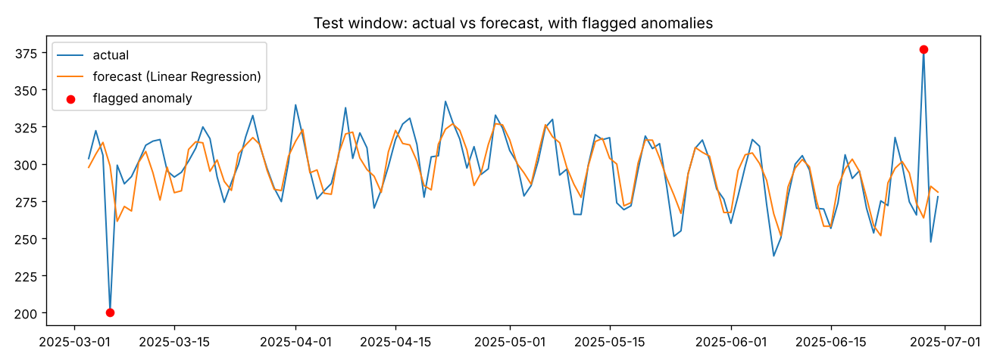

# Demand Forecasting & Anomaly Detection

A small, end-to-end forecasting pipeline in Python: clean daily demand data, build leak-free time-series features, compare models against a seasonal baseline, flag anomalous days from forecast residuals, and run a simple drift check that tells you when to retrain.



## Results

Run on the built-in synthetic series (2.5 years of daily demand with trend, weekly and yearly seasonality, noise, and 12 injected spikes), with the last 120 days held out:

| Model | Test RMSE |
|---|---|
| **Linear Regression** | **19.04** |
| Seasonal naive (same day last week) | 22.33 |
| Random Forest | 25.72 |
| Gradient Boosting | 32.68 |

- Best model beats the seasonal-naive baseline by **15%** on RMSE (MAE 11.73).
- Anomaly detection caught **2 of 2** injected spikes in the test window with **0 false alarms**.
- Drift check: the 28-day mean moved +10.5%, under the 15% retrain threshold.

**What I learned:** the tree models lose to plain linear regression here because the series has an upward trend, and trees cannot predict values outside the range they saw in training. Always compare against a naive baseline before reaching for a bigger model.

## How it works

1. **Load and clean** – sort, de-duplicate, regularise to daily frequency, interpolate only short gaps.
2. **Features** – lags (1, 7, 14, 28 days), rolling mean/std (7, 28 days) computed on `shift(1)` so a row never sees its own value, plus day-of-week, month, weekend flag.
3. **Time-based split** – train on the past, test on the most recent 120 days. No random shuffling.
4. **Models** – seasonal-naive baseline vs Linear Regression, Random Forest, Gradient Boosting (scikit-learn).
5. **Anomalies** – z-score of the forecast residual against the training residual distribution (|z| > 3).
6. **Drift** – compares the recent 28-day mean to the training period and flags a retrain above 15%.
7. **Inference** – `predict_next(model, features, row)` takes one feature row and returns one forecast, ready to wrap in an API.

## Run it

```bash
pip install -r requirements.txt
python run.py                        # synthetic demo data
python run.py --csv your_data.csv    # your own data: columns date,demand
python -m unittest -v                # 5 tests: no leakage, lags, split order, beats baseline, anomaly flags
```

## Project layout

```
src/forecast.py         pipeline functions
run.py                  command-line entry point, prints results and saves the chart
tests/test_forecast.py  unit tests (leakage, split, baseline, anomalies)
docs/                   generated chart
```

Built with Python, pandas, NumPy, scikit-learn and matplotlib.
